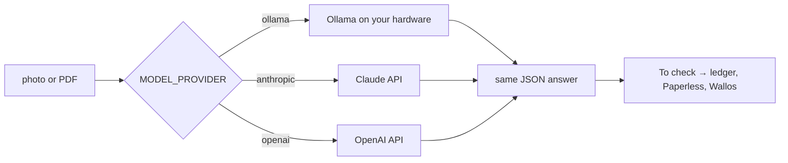

# Plan

What comes next, and what was decided against. The app stays small: [README → Design](README.md#design).

## Branches and releases

| Branch | What it is |
|---|---|
| `main` | Released and deployable. Only merged from `dev` once tested. |
| `dev` | Work in progress. |

Releases are tags on `main` (`v0.1.0`, `v0.2.0`, ...), with notes on what changed and anything to do when upgrading.

## Status

| Item | Status | Size |
|---|---|---|
| Paperless optional (ledger-only mode) |  | M |
| One `compose.yml` with `ollama` and `paperless` profiles |  | S |
| Date order, tax label, categories and currency as settings |  | S |
| Duplicate check by file checksum |  | S |
| Per-person permissions |  | M |
| Cloud models (Claude, OpenAI) as an alternative to Ollama |  | M |
| Prebuilt image on GHCR, so nobody has to build |  | S |
| Decimal-comma amounts (`12,50`) |  | S |
| LICENSE |  | — |
| CSV, email and Actual Budget import |  | — |

## Cloud models

 

### Why

Not everyone has a GPU, and not everyone minds a receipt going to a cloud model. A hosted model also reads item categories better than a 4 B model on a 6 GB card. Today the only choice is Ollama.

### How it would work

- **One setting picks the provider:** `MODEL_PROVIDER=ollama` (the default), `anthropic` or `openai`, with `MODEL` and the provider's API key (`ANTHROPIC_API_KEY`, `OPENAI_API_KEY`).
- **One function per provider:** each takes the photo, the text and the PDF, and returns the same fields the app uses today. Everything after the model stays as it is.
- **Claude:** through the official `anthropic` Python SDK, with structured outputs (`output_config.format` with the app's JSON schema). Photos are sent as image blocks. PDFs are sent as document blocks: Claude reads PDFs itself, so no OCR is needed. The code checks `stop_reason` for `refusal` before reading the answer.
- **OpenAI:** through the official `openai` SDK, with its structured-output mode.
- **Off by default.** Nothing leaves your network unless you set a cloud provider. The README says plainly what is sent and to whom.

### Models and rough cost per receipt

Estimates for a typical receipt (about 3,000 tokens in, 600 out), at list prices on 3 Nov 2026. Real numbers depend on photo size and line count; the app would log each document's token count so you can check.

| Model | ID | Per receipt | Per 100 receipts |
|---|---|---|---|
| Claude Haiku 5.5 | `claude-haiku-5-5` | about $0.0006 | about $0.06 |
| Claude Sonnet 5.5 | `claude-sonnet-5-5` | about $0.012 | about $1.20 |
| Claude Opus 5.5 | `claude-opus-5-5` | about $0.024 | about $2.40 |
| Ollama `gemma3:4b` | local | electricity | electricity |

Haiku is the obvious starting point: extracting fields from a receipt is a small task.

### Open questions

| Question | Options |
|---|---|
| ID papers and visas through a cloud model? | (a) send everything; (b) a **Private** switch on the Capture screen that keeps one upload local; (c) cloud for receipts and bills only, which needs a local model to tell them apart first |
| Fall back to Ollama when the cloud call fails? | Simple to add when both are set; otherwise the document waits under To check, as now |
| Keep sending the OCR text alongside? | Helps a small model; a large one may not need it. Measure on the same receipts. |

### Done when

- The same ten real receipts and bills give the same or better fields as `gemma3:4b`, per provider.
- With `MODEL_PROVIDER=ollama` nothing changes for existing installs.
- The README's privacy section names every provider and what it receives.

## Not planned

| Idea | Why not |
|---|---|
| Bank CSV import | Bank lines and receipts describe the same purchases, so this turns the app into reconciliation: matching, merchant aliases, transfers, refunds. That's a budgeting app's job. |
| Email ingestion | Hard to do safely (inbox access, marketing mail that looks like receipts), and PDFs from email can already be shared into the app by hand. |
| Actual Budget import | Actual already holds the bank side; duplicating it here brings the same matching problem. |
| Budgets, forecasts, bank sync | Out of scope: see [README → Design](README.md#design). |

Input stays manual: a photo, a PDF, or a typed entry.
