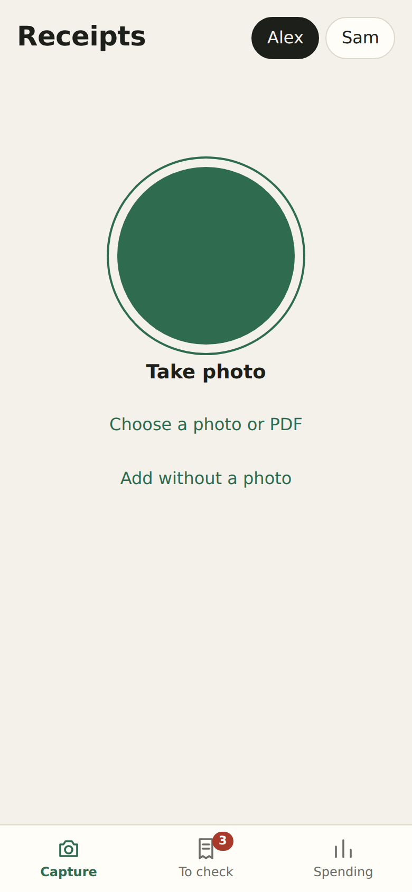
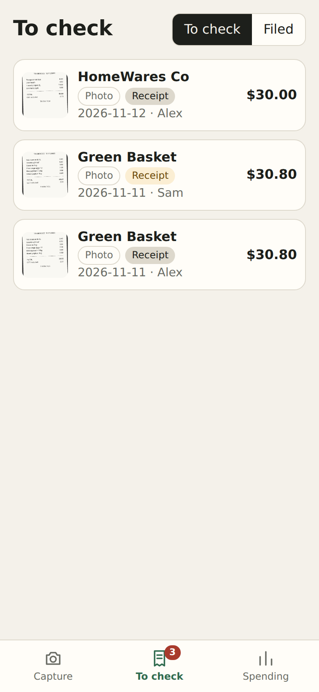
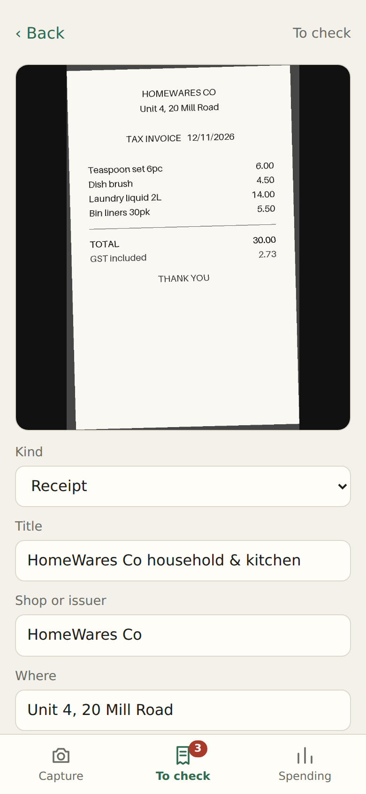
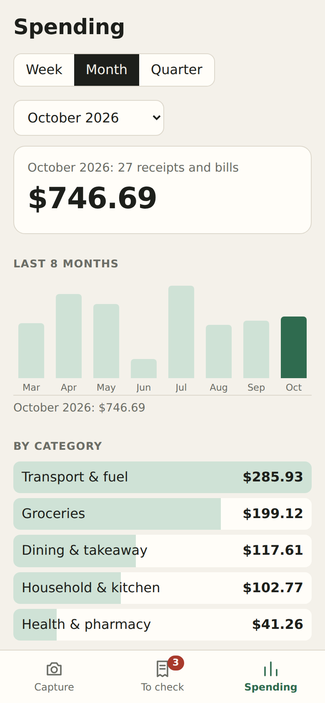
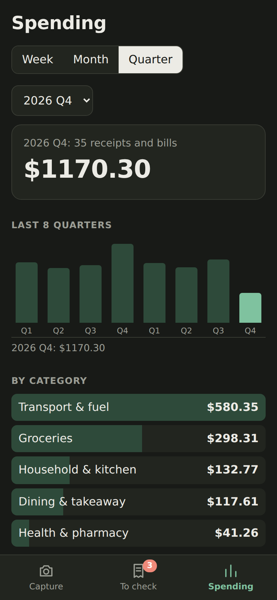
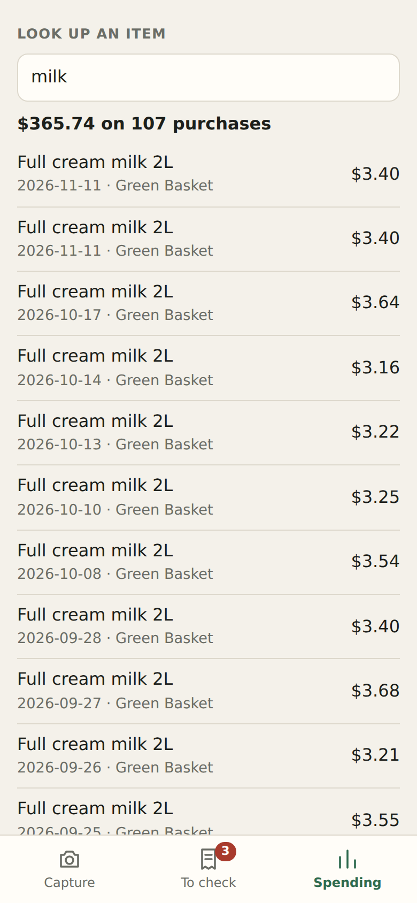
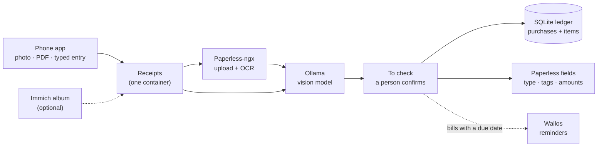

# Receipts

[](https://github.com/ghimireaacs/receipts/tags)
[](LICENSE)
[)](https://github.com/ghimireaacs/receipts/commits/dev)

-black)

Receipts is a self-hosted phone app for receipts, bills and household paperwork. You take a photo or pick a PDF, and a vision model on your own hardware reads it: what kind of document it is, who issued it, the date, the total, the tax and each line item. The purchase goes into a ledger that tracks spending down to the item, so you can answer "how much did we spend on milk this year?" If you run [Paperless-ngx](https://docs.paperless-ngx.com/), the document is filed there as well.

The model runs in [Ollama](https://ollama.com/). Nothing is sent to a cloud service.

## Screenshots

All the data below is made up.

| Capture | To check | Checking a receipt |
|:---:|:---:|:---:|
|  |  |  |
| **Spending, by month** | **By quarter (dark mode)** | **Looking up an item** |
|  |  |  |

## Why it exists

It grew out of moving a household off Google Drive onto a self-hosted setup: Nextcloud for files, Immich for photos and Paperless for documents. That left two jobs none of them did on their own:

1. Knowing where the money goes, down to the item. Not "groceries, $180", but what the milk, the petrol or a single spoon cost, and at which shop.
2. Keeping the important papers findable: passports, visas, citizenship papers, bank and tax letters, insurance and bills, each filed with its dates and its expiry.

The first version used what was already running. Photos went into an Immich album, a script passed them to Paperless, and a local model read them. It worked, but living with it showed four problems. Bills ended up in the photo library, next to the holiday photos and in every backup of it. Capturing one on an iPhone took too many taps: camera, photo library, album, then waiting for the sync. Sometimes the model couldn't load at all, because Immich was analysing the same new picture on the same 6 GB graphics card. And there was nowhere to correct the model, which gets item categories wrong often enough that the totals drifted before anyone noticed.

So capture moved into its own small app. The photo goes straight to the server and never touches the photo library. The model reads it, a person checks it, and only then is it filed. Spending lives in a single SQLite file instead of a spreadsheet, and bills pass their due date to Wallos, which already sends the household's payment reminders.

## Design

The app is meant to stay small, and a few decisions keep it that way.

- It is one container with one database file: Python, FastAPI and SQLite. There is no database server or queue, and the phone app has no build step.
- The model only makes suggestions. Nothing counts until a person has confirmed it.
- It uses what you already run. Only a model is required. Paperless (OCR and the archive), Wallos (reminders), Immich and a sign-in proxy are optional, each set up with a URL and a key in `.env`. Compose can start Ollama and Paperless for you if you don't run them yet.
- Photos, PDFs and the model's answers stay on your own servers.
- It is not a budgeting app. It has no bank sync, budgets, accounts or forecasts, and none are planned. It records what was spent, from the paper that proves it, and adds it up.
- The household (how many people, their names, who can act for others), the document kinds and the categories are settings rather than code.

## People and permissions

The household is a list of names in `PEOPLE`. Who may do what depends on how people sign in:

| Sign-in | Who can add, see and change entries |
|---|---|
| A sign-in proxy that names each person (`AUTH_PEOPLE` set) | Each person only their own. People listed in `ADMINS` may add, see and change entries for anyone. Someone signed in who isn't in `AUTH_PEOPLE` can't use the app. |
| One shared passcode, or none | Everyone, for everyone. The app can't tell people apart. |

The spending totals always cover the whole household. They show a breakdown per person, but not anyone's documents.

## What it does

| | |
|---|---|
| Capture | One button opens the camera, or you pick photos and PDFs from the phone. A photo taken while the server is out of reach waits on the phone and goes later. |
| Reading | The model works out the kind of document: receipt, bill, ID document, visa, certificate, bank statement, payslip, insurance and more. For receipts and bills it reads the shop or biller, location, dates, total, tax, payment method, category and line items. |
| To check | Every document waits for a person to confirm it. The form shows the photo next to what was read, and says when the items don't add up to the total. |
| Filing | When you confirm, the ledger gets one row for the purchase and one for each item. With Paperless, the document also gets its type, storage path, correspondent, title, tags and custom fields. |
| Spending | Totals by week, month or quarter, a chart of the last eight periods, a breakdown by category, shop and person, and a search across items. |
| No receipt | Petrol, cash, anything without paper can be typed in. It counts in the ledger and the totals and goes nowhere else. |
| Duplicates | The same file sent twice is flagged straight away, by its checksum. Two different photos of one receipt or bill are flagged when they share a barcode, a printed transaction or invoice number, the same shop, date and total, or, for bills, the same biller and amount within a month. |
| Bills to Wallos | Optional. A confirmed bill with a due date creates or updates its entry in [Wallos](https://github.com/ellite/Wallos), and Wallos sends the reminder on whatever channel you gave it (Mattermost, ntfy, email, Discord and others). |
| Immich | Optional. Photos added to an [Immich](https://immich.app/) album named `Paperless` are taken in too, then removed from the album. |

## How it works



The container is a small Python service: FastAPI for the app and its API, a background worker, and SQLite for the ledger. The phone app is plain HTML and JavaScript with no build step, and installs to the home screen as a web app.

## Requirements

| Service | Needed | Notes |
|---|---|---|
| Docker with Compose | Yes | |
| [Ollama](https://ollama.com/) with a vision model | Yes | Tested with `gemma3:4b` (about 3.3 GB). A GPU with 6 GB is enough; on CPU alone a receipt takes minutes instead of about 30 seconds. |
| [Paperless-ngx](https://docs.paperless-ngx.com/) | Optional | OCR text (better numbers from photos) and the archive. Without it the app keeps its own copy of every photo and PDF. |
| A reverse proxy with HTTPS | Strongly advised | iPhones only install the app to the home screen, and keep photos offline, over HTTPS |
| [Wallos](https://github.com/ellite/Wallos) | Optional | Bill reminders |
| [Immich](https://immich.app/) | Optional | A second way in |
| Authentik, Authelia or another forward-auth proxy | Optional | Sign-in per person, instead of one shared passcode |

## Quick start

1. **Get the code and the settings file.**

   ```bash
   git clone https://github.com/ghimireaacs/receipts.git && cd receipts
   cp .env.example .env
   ```

2. **Pick your setup.** One `compose.yml` covers all of them. Turn on a profile for each service you want compose to run; for one you already run, put its address in `.env` instead.

   | You already run | Start with | In `.env` |
   |---|---|---|
   | Nothing | `docker compose --profile ollama up -d --build` | `OLLAMA_URL=http://ollama:11434`, `PAPERLESS_URL` empty |
   | Nothing, and you want Paperless too | `docker compose --profile ollama --profile paperless up -d --build` | also `PAPERLESS_URL=http://paperless:8000` and `PAPERLESS_USER` / `PAPERLESS_PASSWORD` |
   | Ollama | `docker compose up -d --build` | `OLLAMA_URL=http://<its address>:11434` |
   | Ollama and Paperless | `docker compose up -d --build` | both addresses, and a Paperless token or user and password |

   Also set `APP_PASSCODE`, `PEOPLE`, and your `CURRENCY`, `DATE_ORDER` and `TAX_LABEL`.

3. **Pull the model** (once), on the Ollama host or with `docker compose exec ollama`:

   ```bash
   ollama pull gemma3:4b
   ```

4. **With Paperless only: prepare it** (once). This creates the document types, tags, storage paths and custom fields the app files into. It only adds what is missing and never changes what is already there.

   ```bash
   docker compose run --rm receipt-bridge python setup_paperless.py
   ```

5. **Open it** at `http://<host>:8098`, or at your proxy's HTTPS address. Enter the passcode, then add it to the home screen:
   - **iPhone (Safari):** Share → Add to Home Screen.
   - **Android (Chrome):** menu → Install app.

## Using it

| Tab | What it does |
|---|---|
| Capture | Pick whose it is, tap the big button, take the photo. **Choose a photo or PDF** for several at once or for a PDF. **Add without a photo** for an expense with no receipt. |
| To check | Each document once the model has read it, marked Photo, PDF or No photo. Open one, fix what it got wrong, tap **Looks right, file it**. |
| Spending | Week, month or quarter: the total, the last eight periods, by category, shop and person, and an item lookup. |

- **Delete** removes the photo and its ledger rows, and moves the Paperless document to the Paperless trash. An upload can also be deleted while it is still being read: the worker stops at its next step.
- **Read again** sends a document back to the model, for example after a model change.
- Photos waiting to be sent live in the browser's storage on the phone. Don't clear the app's website data while photos are waiting.

## Connecting services you already run

Every connection is a URL and a key in `.env`; nothing has to be in the same Compose project. A service on another host, or in another Compose project on the same host, works the same way as long as its URL is reachable from this container. On one host, use the host's LAN address: `localhost` inside a container means the container itself.

### Paperless-ngx

- Without it: leave `PAPERLESS_URL` empty. Photos and PDFs stay in `PHOTO_STORE`, the model reads the photo (and a PDF's own text), and the categories come from `CATEGORIES` and `PAYMENT_METHODS`. You lose OCR, which helps the model with numbers on photos, and Paperless's archive and search.
- `PAPERLESS_URL`: the internal address, for example `http://192.0.2.10:8000`. A public HTTPS name works too.
- `PAPERLESS_TOKEN`, or **`PAPERLESS_USER` and `PAPERLESS_PASSWORD`** (the app fetches a token itself): a user who may create documents, tags, fields and correspondents.
- Setup: run `setup_paperless.py` once (step 4). These are the names it creates and the app looks up:

  | Kind | Names |
  |---|---|
  | Document types | Receipt, Bill / Invoice, Identity document, Visa / Immigration, Certificate / Qualification, Bank statement, Payslip, Tax document, Insurance, Contract / Agreement, Academic record, Medical, Vehicle, Warranty / Manual, Letter / Notice, Other |
  | Tags | `from-phone`, `inbox`, `to-pay`, `vital`, `warranty` |
  | Storage paths | Receipts, Bills, Vital, Financial |
  | Custom fields | Amount, GST (monetary); Expense category, Payment method (select); Store location, Document number (text); Line items (long text); Due date, Expiry date, Issue date (date) |

- Your own names: to file under names you already use, edit the `KINDS` table at the top of `bridge.py` before running the setup.
- Categories and payment methods are the select options of the Expense category and Payment method fields. Edit them in Paperless; the app picks up changes within five minutes.
- Per-person tags: give each person an owner tag in Paperless and put its id in `PEOPLE` (`Alex:17,Sam:18`). The id is in the address bar when you open the tag in Paperless.

### Ollama

- `OLLAMA_URL`: for example `http://192.0.2.20:11434`. If Ollama is bundled with Open WebUI, use the address of the Ollama API port, not the Open WebUI page.
- `OLLAMA_MODEL`: any vision model Ollama can serve. `gemma3:4b` fits a 6 GB card. Larger models read item categories better if you have the memory.
- A shared GPU (Immich's machine learning, for example) is fine. When the model can't load, the worker waits and tries again for about three minutes, then leaves the document for you to fill in.

### Wallos

- In Wallos: Profile → API key. For notifications, set up the channel you want under Settings → Notifications.
- `WALLOS_URL`: the internal address, for example `http://192.0.2.10:8282`.
- `WALLOS_CURRENCY_ID`: your currency's id in Wallos.
- `WALLOS_NOTIFY_DAYS`: how many days before the due date Wallos should remind you. Wallos reminds once, on the day exactly that many days ahead, so a bill filed later than that gets no reminder for its current due date.
- Matching is by biller name. A new biller is added as monthly; change the cycle in Wallos once if it's quarterly. Later bills from the same biller update its price and due date.

### Immich

- `IMMICH_URL` and `IMMICH_API_KEY` (Account Settings → API Keys). Create an album named `Paperless`, or set `ALBUM_NAME`, and share it with everyone who should use it.
- After filing: photos owned by the key's account are archived out of the timeline, not deleted. Photos from other people are only taken out of the album.

### Reverse proxy and sign-in

- Proxy only. Point the proxy at `http://<host>:8098`. If the proxy runs on the same host, set `APP_BIND=127.0.0.1` so the port isn't open to the network. Keep `APP_PASSCODE` set.
- Forward-auth (Authentik, Authelia, oauth2-proxy). Protect the route, leave `APP_PASSCODE` empty, and map usernames to people:

  ```env
  AUTH_PEOPLE=alex=Alex,sam=Sam
  PROXY_IPS=192.0.2.10
  ```

  The app reads the username from the `X-authentik-username` header, and trusts it only when the connection itself comes from an address in `PROXY_IPS` (`X-Forwarded-For` is ignored, so the header can't be faked from elsewhere on the network). Requests with no known person are refused, including ones made straight to the app's port. With another proxy, pass its username header on under that name (Authelia sends `Remote-User`). Make the proxy's sessions long: phones close browser sessions often, and every expiry means signing in again.
- Traefik with Authentik's embedded outpost. Put the forward-auth middleware on the app's router, and add a second router for `Host(...) && PathPrefix(/outpost.goauthentik.io/)` that goes to Authentik.

## Settings

| Setting | Default | Meaning |
|---|---|---|
| `PAPERLESS_URL` | empty | Paperless API; empty = run without Paperless |
| `PAPERLESS_TOKEN` or `PAPERLESS_USER`, `PAPERLESS_PASSWORD` | empty | Paperless login (a token, or a user the app gets a token for) |
| `OLLAMA_URL`, `OLLAMA_MODEL` | `gemma3:4b` | The vision model |
| `DB_DIR` | `./data/db` | Folder for `ledger.db` and the session key. Use a local disk: SQLite on a network share can be corrupted. |
| `PHOTO_STORE` | `./data/store` | Photos (`photos/`: full size, a smaller copy, and the original of a PDF) and the daily ledger copy (`backup/`) |
| `APP_BIND`, `APP_PORT` | `127.0.0.1`, `8098` | Where the app listens on the host |
| `APP_PASSCODE` | empty | Shared passcode; empty means no sign-in |
| `PEOPLE` | empty | `Name`, or `Name:paperless-tag-id:immich-user-id`; comma separated |
| `CURRENCY` | `AUD` | ISO code for amounts |
| `DATE_ORDER` | `DMY` | How dates are printed on your receipts: `DMY`, `MDY` or `YMD` |
| `TAX_LABEL` | `GST` | What receipts call the tax (`VAT`, `Tax` ...); used in the form and the model's instructions |
| `CATEGORIES`, `PAYMENT_METHODS` | built-in lists | Comma separated. Without Paperless they are the choices; with Paperless the select fields there are, and these seed `setup_paperless.py`. |
| `AUTH_PEOPLE`, `PROXY_IPS` | empty | Proxy username → person, and the addresses allowed to send the header |
| `ADMINS` | empty | People (names from `PEOPLE`) who may act for everyone when `AUTH_PEOPLE` is set |
| `IMMICH_URL`, `IMMICH_API_KEY`, `ALBUM_NAME`, `POLL_SECONDS` | empty, `Paperless`, `120` | Immich intake |
| `WALLOS_URL`, `WALLOS_API_KEY`, `WALLOS_NOTIFY_DAYS`, `WALLOS_CURRENCY_ID` | empty, `3`, `1` | Wallos bill sync |
| `TZ` | | Time zone for dates and the start of the week |

## Your data

- The ledger is one SQLite file, `DB_DIR/ledger.db`:

  | Table / view | Holds |
  |---|---|
  | `docs` | every photo, PDF or manual entry: source, person, status, Paperless id, what was read |
  | `purchases` | one row per receipt or bill: date, merchant, location, total, GST, payment method, category, person |
  | `items` | one row per line: name, quantity, price, category |
  | `item_spend` | view joining the two |

  ```sql
  select name, sum(price) from item_spend where name like '%milk%' group by name;
  ```

- Session key. `DB_DIR/session.key` signs the passcode cookie; deleting it signs every phone out.
- Backups. A copy of the ledger is written to `PHOTO_STORE/backup/ledger.db` once a day. Back up `PHOTO_STORE` with your other files. For a copy of the live file, pause the container for the few seconds it takes to copy `DB_DIR`.
- Privacy. Photos and PDFs go only to your Paperless and your Ollama. Treat the app's address like Paperless's: ID papers can pass through it.

## Updating

```bash
git pull
docker compose up -d --build
```

The ledger's tables are updated in place on start. On the phone, close the app and open it again to load the new version.

## Known limits

- A small model reads shops, totals, tax and dates well, and item categories less well. That's why every document waits for a check.
- Amounts are read with a decimal point (`12.50`); a decimal comma (`12,50`) isn't handled yet.
- iPhone home-screen apps can't upload in the background: a waiting photo goes the next time the app is open.
- Barcodes on folded or crumpled receipts usually can't be decoded; the other duplicate checks still apply.
- Without Paperless there is no OCR: on a photo the model reads the numbers from the image alone, which is less reliable. When the day and month of a date could be swapped, the app keeps the reading nearer the day the photo was taken.
